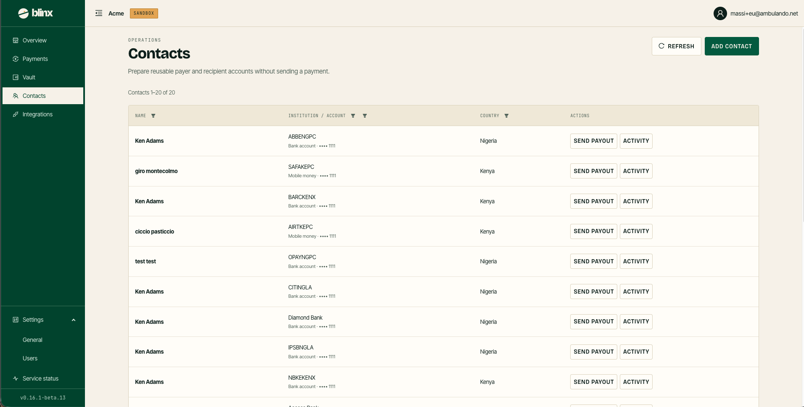

# Contacts

**Route:** `/tenant/payers`

<figure><figcaption></figcaption></figure>

Contacts are the reusable payer and recipient accounts linked to your tenant — *prepare reusable payer and recipient accounts without sending a payment.* Saving a contact here means you can pick it later instead of re-entering account details. The page head carries **Refresh** and **Add contact**.

### The table

| Column | Description |
|---|---|
| **Name** | The contact's name, with their city underneath |
| **Institution / account** | The bank or mobile-money provider, with the payment type and masked account number (e.g. *Bank account · •••• 1111*) underneath |
| **Country** | The contact's country |
| **Actions** | **Send payout** opens [Send payout](send.md) with this contact preselected; **Activity** opens [Payments](payments.md) filtered to this contact |

The **Name**, **Institution / account** and **Country** headers carry funnel filters, and the list is paged (shown as "Contacts 1–N of N").

### Add contact

**Add contact** opens a dialog to create a verified recipient from the country, institution and account number — the account holder is looked up automatically before the contact is saved. When a contact has no payments yet, its **Activity** opens an empty payments list.
