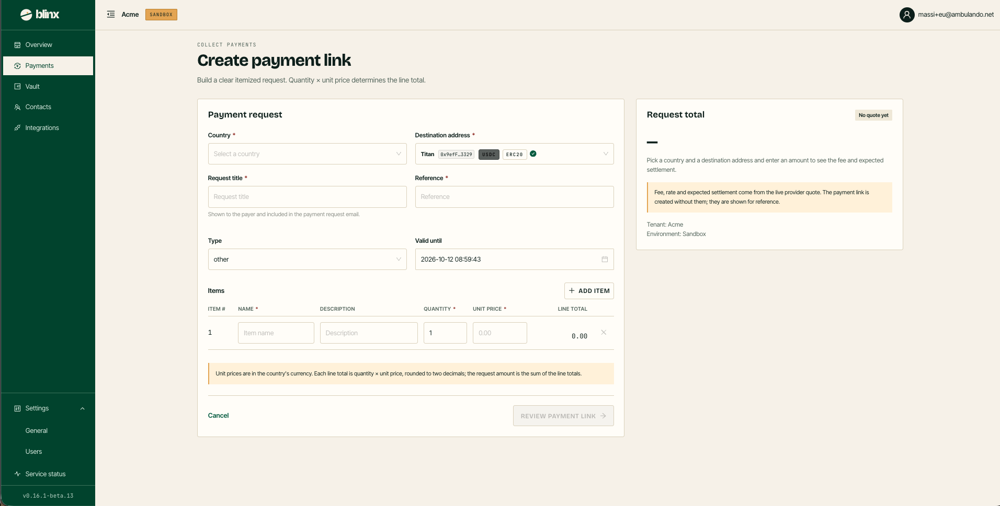
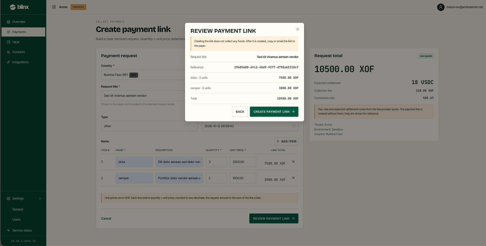
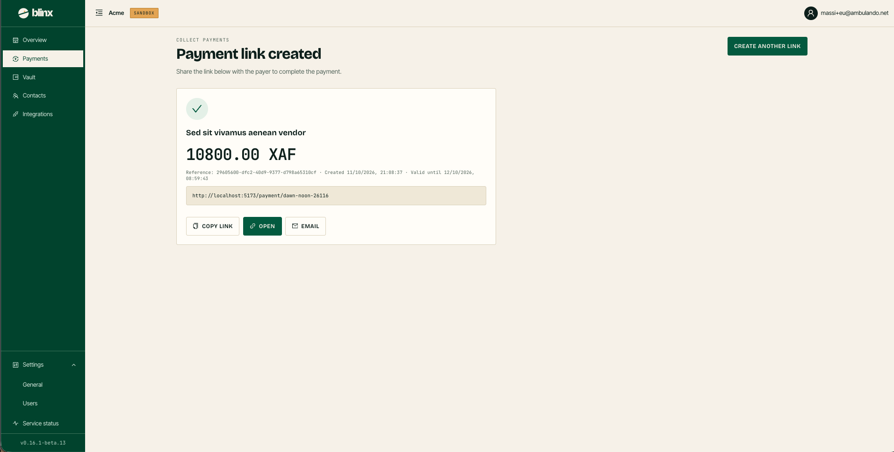

# Create payment link

**Route:** `/tenant/payments/new`

<figure><figcaption></figcaption></figure>

Create a **payment link** — an itemized request you share with a payer so they can pay you. *Build a clear itemized request. Quantity × unit price determines the line total.* Blinx generates the link; you can copy it, open it, or email it to the payer.

### Payment request

| Field | Notes |
|---|---|
| **Country** | The payer's country. Selecting it sets the currency automatically. **Required** |
| **Destination address** | The vault asset that receives the funds. Only active assets are listed; each shows the label, shortened address, token and network, with a check on your default (pre-selected). **Required** |
| **Request title** | Shown to the payer and included in the payment request email. **Required** |
| **Reference** | Your own reference for the request. **Required** |
| **Type** | The reason for the payment (gift, bills, groceries, …). Defaults to **other** |
| **Valid until** | An expiry date and time for the link. Must be at least 1 hour out |

Required fields are marked with a red asterisk after the label.

### Items

Build the amount from line items rather than typing a total. Each row has **Item # · Name\* · Description · Quantity\* · Unit price\* · Line total**, and a line total of *quantity × unit price* (rounded to two decimals). **Add item** adds a row; the × removes one. The **request amount is the sum of the line totals**, in the country's currency.

### Request total (aside)

A sticky **Request total** card shows the request amount and, once a quote is available, the **expected settlement**, **collection fee** and **conversion rate** for reference. The badge reads *No quote yet* / *Live quote*. The link is created without these figures — they come from the live provider quote and are shown for reference only.

### Review and create

**Review payment link** opens a dialog summarising the title, reference, items and total.

<figure><figcaption></figcaption></figure>

Confirm with **Create payment link** to generate it.

<figure><figcaption></figcaption></figure>

On the result screen you can **Copy** the link, **Open** it, **Email the payer**, or **Create another link**.
