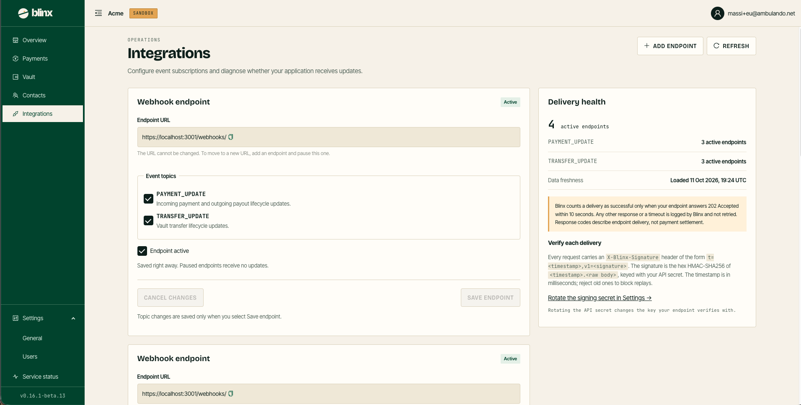

# Integrations

**Route:** `/tenant/webhooks`

<figure><figcaption></figcaption></figure>

Integrations is where you subscribe your application to Blinx events — *configure event subscriptions and diagnose whether your application receives updates.* The page head carries **Add endpoint** and **Refresh**.

### Webhook endpoints

Each endpoint is a card:

| Element | Meaning |
|---|---|
| **Status** | **Active** or **Paused** |
| **Endpoint URL** | Where Blinx POSTs events. The URL cannot be changed — to move to a new URL, add an endpoint and pause this one |
| **Event topics** | Which events this endpoint receives: **`PAYMENT_UPDATE`** (incoming payment and outgoing payout lifecycle updates) and **`TRANSFER_UPDATE`** (vault-transfer lifecycle updates) |
| **Endpoint active** | Toggles whether the endpoint receives updates. Paused endpoints receive nothing |
| **Save endpoint** / **Cancel changes** | Topic and active changes are saved only when you select **Save endpoint** |

**Add endpoint** opens a dialog for a new URL and its topics.

### Delivery health

A side card summarises delivery:

* The number of **active endpoints**, and how many subscribe to each topic (`PAYMENT_UPDATE`, `TRANSFER_UPDATE`).
* **Data freshness** — when the view was loaded.
* A note that Blinx counts a delivery as successful **only when your endpoint answers `202 Accepted` within 10 seconds**. Any other response or a timeout is logged and **not retried**. Response codes describe endpoint delivery, not payment settlement.

### Verify each delivery

Every request carries an **`X-Blinx-Signature`** header of the form `t=<timestamp>,v1=<signature>`. The signature is the hex **HMAC-SHA256** of `<timestamp>.<raw body>`, keyed with your API secret. The timestamp is in milliseconds — reject old ones to block replays. Rotating the API secret (in [Settings — General](settings-general.md)) changes the key your endpoint verifies with.
