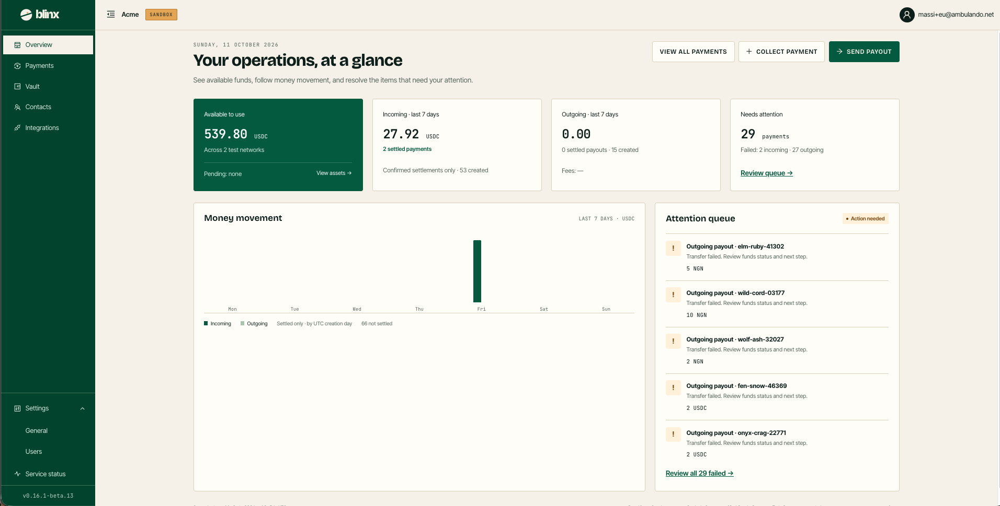

# Overview

**Route:** `/tenant/overview`

<figure><figcaption></figcaption></figure>

Overview is your landing page — *your operations, at a glance*. It shows available funds, how money has moved over the last 7 days, and the items that need your attention. Every figure is real data for your tenant; there are no illustrative numbers.

The page head carries three quick actions: **View all payments**, **Collect payment** (opens [Receive by bank transfer](receive.md)) and **Send payout** (opens [Send payout](send.md)). The two money-moving buttons are disabled until your tenant can operate (see [Settings — General](settings-general.md)).

### The four cards

| Card | What it shows |
|---|---|
| **Available to use** | Your spendable vault balance, headlined by the largest per-token total with the others on an "Also" line. Shows how many networks hold funds, any **Pending** (not spendable) amount, and a **View assets →** link to the [Vault](vault.md) |
| **Incoming · last 7 days** | Settled incoming payments over the window, the count of settled payments, and how many were created |
| **Outgoing · last 7 days** | Settled outgoing payouts over the window, the count created, and the fees charged |
| **Needs attention** | The number of **failed** payments, split into incoming vs outgoing, with a **Review queue →** link to the filtered [Payments](payments.md) list |

> Totals are per token — there is no currency conversion between tokens. Pending funds are excluded from the available balance.

### Money movement

A chart of **settled** incoming vs outgoing amounts per UTC day over the last 7 days, in a single token. A legend distinguishes **Incoming** from **Outgoing**; amounts settled in other tokens, or not yet settled, are noted below the chart rather than drawn.

### Attention queue

The newest failed transfers, each with its title, failure reason and amount. Every item links to its [transaction detail](payments.md); a **Review all N failed →** link opens the full failed list. When nothing has failed, the card reads "Nothing needs your attention".
