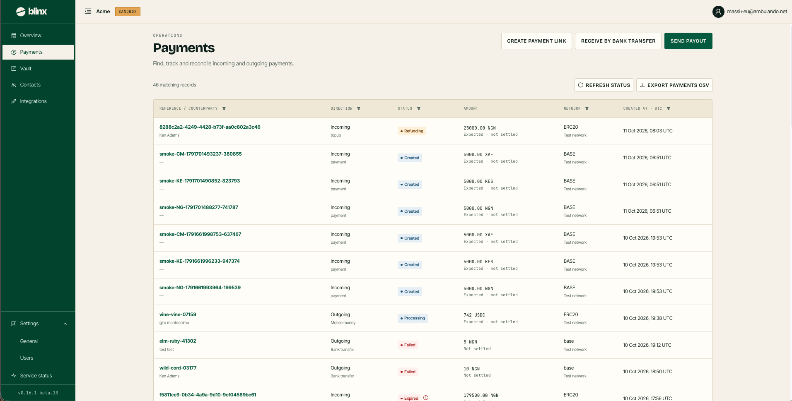
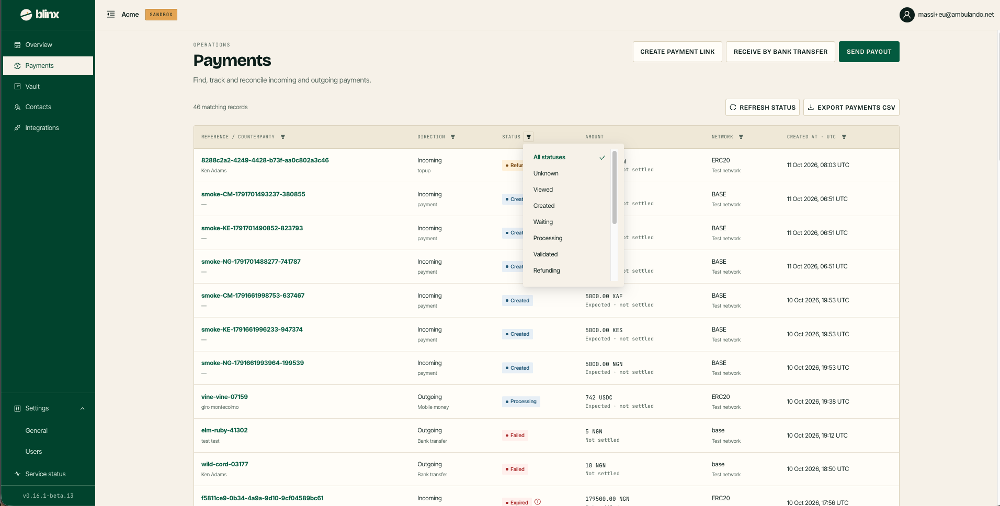

# Payments

**Route:** `/tenant/payments`

<figure><figcaption></figcaption></figure>

Payments is one unified list of every **incoming** payment and **outgoing** payout for your tenant — *find, track and reconcile incoming and outgoing payments*. It replaces the separate "Payments In" and "Sends History" pages.

The page head carries the three money-moving actions: **Create payment link**, **Receive by bank transfer** and **Send payout**. Above the table, a record count sits next to **Refresh status** and **Export payments CSV**.

### The table

| Column | Description |
|---|---|
| **Reference / counterparty** | The reference (a link to the transaction detail), with the counterparty underneath. A payment with no payer recorded shows a **Payer missing** tag |
| **Direction** | **Incoming** or **Outgoing**, with the method underneath (payment link, bank transfer / topup, payout, mobile money) |
| **Status** | A coloured status tag — e.g. **Created**, **Processing**, **Settled**, **Refunding**, **Expired**, **Failed**. A failed/expired row shows a red **ⓘ**; hover it for the reason |
| **Amount** | The amount and currency, with a settlement note (e.g. *Expected · not settled*, *Settled*, *Not settled*) underneath |
| **Network** | The settlement network, with *Test network* in sandbox |
| **Created at · UTC** | When the record was created — the list is newest-first |

### Filtering

Each filterable column header carries a **funnel** button that opens a popover:

<figure><figcaption></figcaption></figure>

* **Reference / counterparty** — search by reference or counterparty name.
* **Direction** — incoming or outgoing.
* **Status** — pick one or more statuses.
* **Network** — filter by settlement network.
* **Created at · UTC** — filter by a date range.

Active filters narrow the list server-side and update the record count. **Export payments CSV** exports the current (filtered) list; the file is named with the date and time.

### Transaction detail

Clicking a row's reference opens its detail page — the amount, status, the key reference/counterparty/rate/fee/timestamp fields, and, for a payout, its delivery timeline. Rows that link here include the entries in the [Overview](overview.md) attention queue and the [Vault](vault.md) transfers table.
