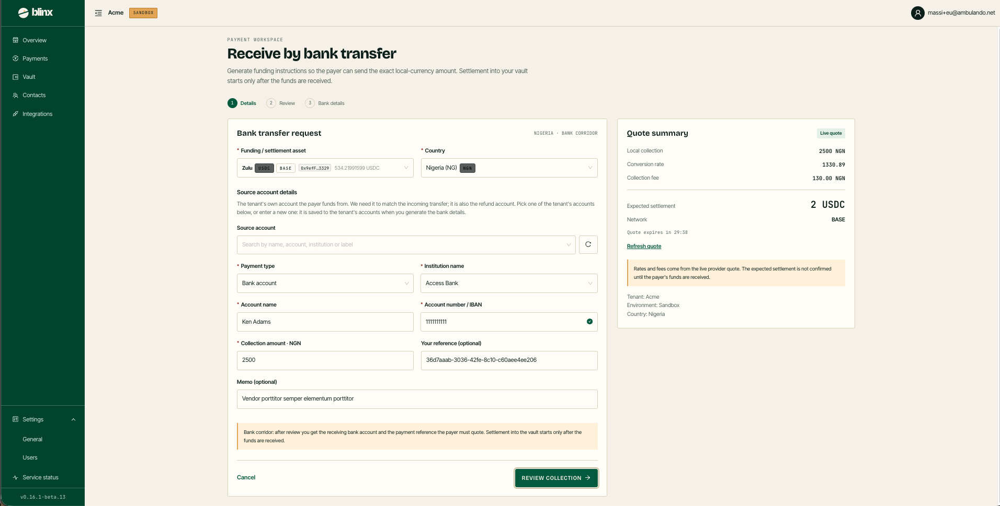
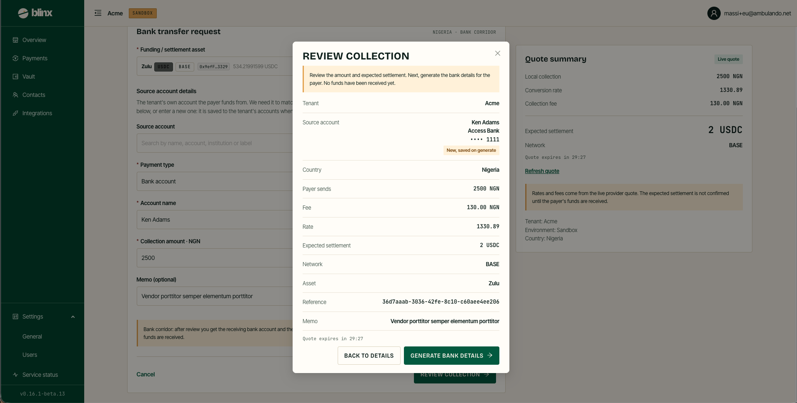
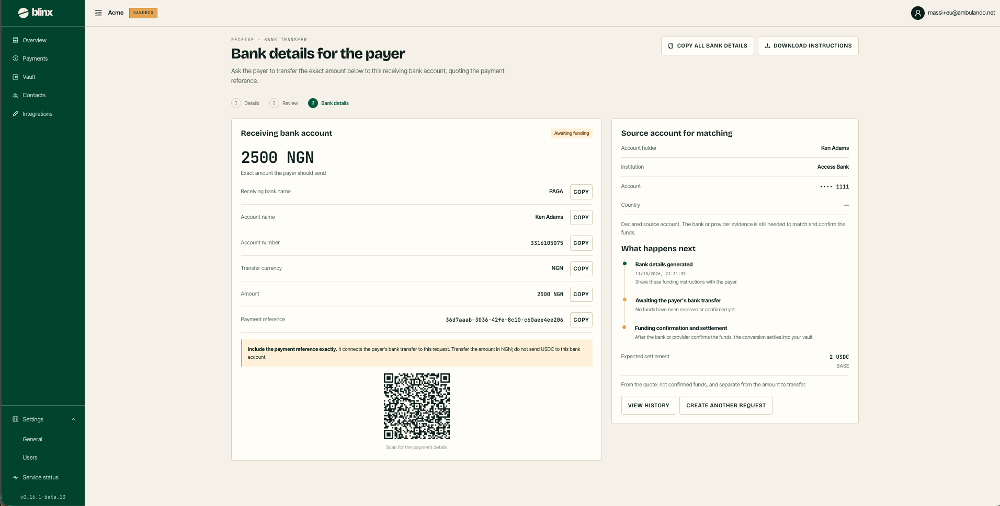

# Receive by bank transfer

**Route:** `/tenant/receive`

<figure><figcaption></figcaption></figure>

Collect a payment by generating funding instructions for a payer — *generate funding instructions so the payer can send the exact local-currency amount. Settlement into your vault starts only after the funds are received.* A step indicator tracks the flow: **Details → Review → Bank details**.

### Bank transfer request

| Field | Notes |
|---|---|
| **Funding / settlement asset** | The vault asset the collection settles into — token, network, address and available balance. **Required** |
| **Country** | The corridor's country, which sets the collection currency. **Required** |
| **Source account details** | The tenant's own account the payer funds from. Blinx needs it to match the incoming transfer; it is also the refund account. Pick a saved account, or enter a new one (saved to the tenant's accounts when you generate the bank details) |
| **Payment type** | Bank account or mobile money. **Required** |
| **Institution name** | The source institution. **Required** |
| **Account name** / **Account number · IBAN** | The source account holder and number; the account is verified automatically. **Required** |
| **Collection amount · {currency}** | The local-currency amount to collect. **Required** |
| **Your reference** / **Memo** | Optional notes for your own records |

A notice explains the bank corridor: after review you receive the receiving bank account and the payment reference the payer must quote; settlement into the vault starts only after the funds arrive.

### Quote summary (aside)

A sticky **Quote summary** shows the **local collection** amount, **conversion rate**, **collection fee**, the **expected settlement** (the token amount that reaches your vault) and the settlement **network**, with a **Refresh quote** control and a live expiry countdown.

### Review and bank details

**Review collection** opens a dialog to confirm.

<figure><figcaption></figcaption></figure>

Confirm with **Generate bank details** to produce the receiving account and payment reference to share with the payer.

<figure><figcaption></figcaption></figure>
