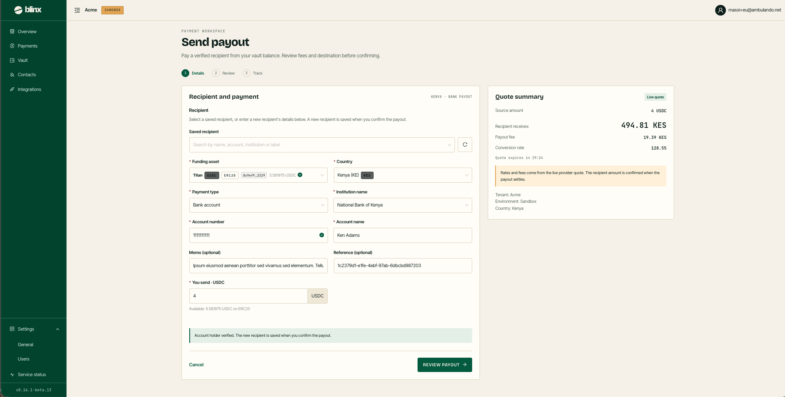
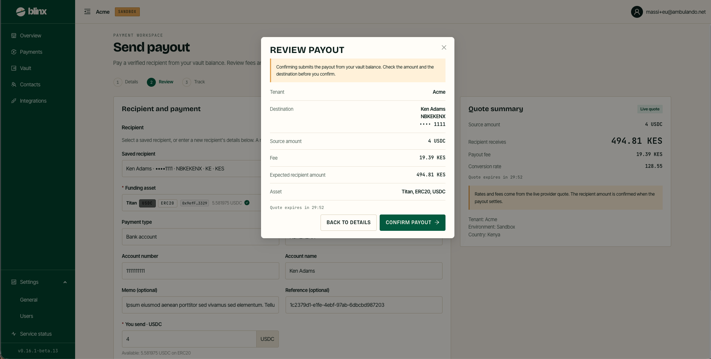
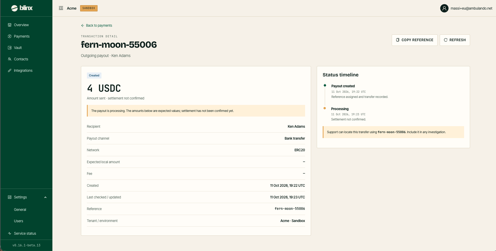

# Send payout

**Route:** `/tenant/send`

<figure><figcaption></figcaption></figure>

Send a payout from your vault balance to a recipient's bank account or mobile-money wallet — *pay a verified recipient from your vault balance. Review fees and destination before confirming.* A step indicator tracks the flow: **Details → Review → Track**.

### Recipient and payment

Pick a **saved recipient** from the search, or enter a new one's details below (a new recipient is saved when you confirm the payout).

| Field | Notes |
|---|---|
| **Funding asset** | The vault asset you pay from — shows token, network, address and the available balance. **Required** |
| **Country** | The recipient's country, which sets the payout currency. **Required** |
| **Payment type** | Bank account or mobile money. **Required** |
| **Institution name** | The recipient's bank or mobile-money provider. **Required** |
| **Account number** | The recipient's account; the **account holder is looked up and verified** automatically (a green check appears). **Required** |
| **Account name** | The verified account holder. **Required** |
| **Memo** / **Reference** | Optional notes for your own records |
| **You send · {token}** | The amount to debit from the funding asset, as whole token units. Only the **settled** balance is spendable. **Required** |

A notice confirms the account holder is verified before you can review.

### Quote summary (aside)

A sticky **Quote summary** card shows the **source amount**, what the **recipient receives**, the **payout fee** and the **conversion rate**, with a live **Quote expires in m:ss** countdown that re-requests the quote at expiry. Rates and fees come from the live provider quote; the recipient amount is confirmed when the payout settles.

### Review and confirm

**Review payout** opens a dialog with the recipient, funding asset and amounts.

<figure><figcaption></figcaption></figure>

Confirm to submit; you are taken to the payout's transaction detail to track it.

<figure><figcaption></figcaption></figure>
