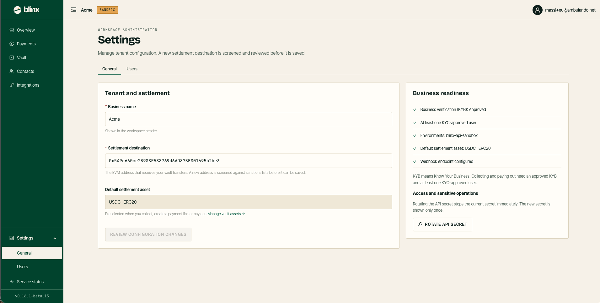

# Settings — General

**Route:** `/tenant/settings`

<figure><figcaption></figcaption></figure>

Settings is your *workspace administration* area — *manage tenant configuration. A new settlement destination is screened and reviewed before it is saved.* A sub-navigation at the top switches between **General** (this page) and [**Users**](settings-users.md).

### Tenant and settlement

| Field | Notes |
|---|---|
| **Business name** | Your tenant's display name, shown in the workspace header |
| **Settlement destination** | The EVM address that receives your vault transfers. A new address is **screened against sanctions lists** and reviewed before it can be saved |
| **Default settlement asset** | The asset preselected when you collect, create a payment link or pay out. A **Manage vault assets →** link opens the [Vault](vault.md) |

**Review configuration changes** is enabled once you change a value, and opens a review before anything is saved.

### Business readiness

A checklist of what your tenant needs to operate, each ticked when met:

* **Business verification (KYB): Approved**
* **At least one KYC-approved user**
* **Environments** (e.g. `blinx-api-sandbox`)
* **Default settlement asset** set
* **Webhook endpoint configured**

> KYB means Know Your Business. Collecting and paying out need an approved KYB **and** at least one KYC-approved user — until both are met, the money-moving actions across the dashboard are disabled.

### Access and sensitive operations

Rotate your API secret here. Rotating **stops the current secret immediately**, and the new secret is **shown only once** — copy it before closing. **Rotate API secret** opens the dialog with the warning and the new value.

> The secret cannot be retrieved again; if you lose it, rotate to get a new one. Rotating also changes the key your webhook endpoints verify signatures with (see [Integrations](integrations.md)).
