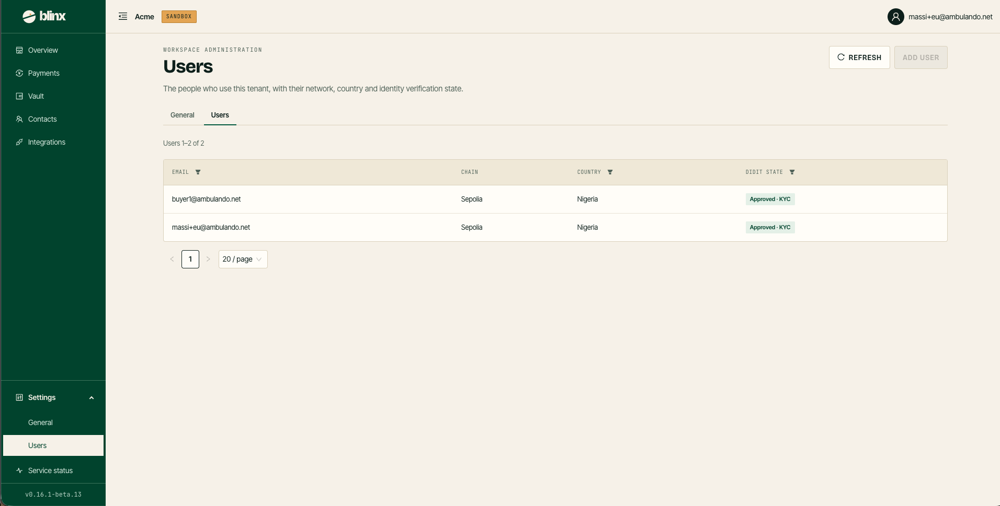

# Settings — Users

**Route:** `/tenant/settings/users`

<figure><figcaption></figcaption></figure>

The Users subpage lists the people who use this tenant — *the people who use this tenant, with their network, country and identity verification state.* It sits under [Settings](settings-general.md); use the **General | Users** sub-navigation to switch, or open **Settings → Users** from the sidebar. The page head carries **Refresh** and **Add user**.

### The table

| Column | Description |
|---|---|
| **Email** | The user's email address |
| **Chain** | The network their account is on (e.g. Sepolia) |
| **Country** | Their country |
| **Didit state** | Their identity-verification state — e.g. a green **Approved · KYC**, or **Pending · KYC** |

The **Email**, **Country** and **Didit state** headers carry funnel filters, and the list is paged (shown as "Users 1–N of N").

> At least one **KYC-approved** user is part of your tenant's [business readiness](settings-general.md) — it is required before you can collect or pay out.
