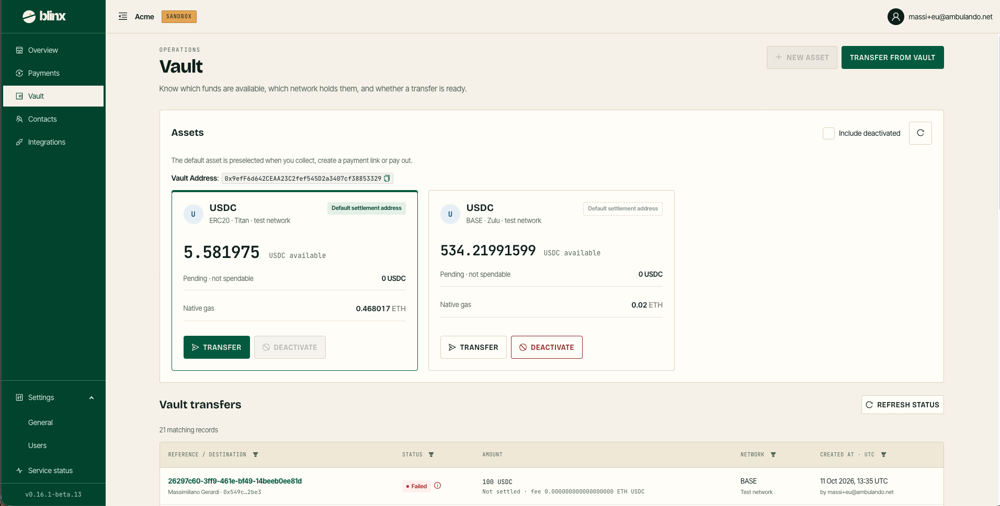

# Vault

**Route:** `/tenant/vault`

<figure><figcaption></figcaption></figure>

The Vault page brings your assets and their transfer history together — *know which funds are available, which network holds them, and whether a transfer is ready.* It replaces the separate "Vault — Assets" and "Vault — Transactions" pages. The page head carries **New asset** and **Transfer from vault**.

### Assets

The **Vault address** is shown with a copy control, and the default asset is the one preselected when you collect, create a payment link or pay out. An **Include deactivated** toggle and a refresh control sit above the cards.

Each asset is a card:

| Element | Meaning |
|---|---|
| **Token · network** | The asset's token, network and label (the default is highlighted and marked **Default settlement address**) |
| **Available** | The spendable balance |
| **Pending · not spendable** | Funds not yet settled |
| **Native gas** | The native-token balance that pays for on-chain fees |
| **Transfer** | Move funds from this asset to an external address |
| **Deactivate** | Hide the asset from the selectors (the default asset cannot be deactivated). A non-default card's greyed **Default settlement address** control makes that asset the default |

**Transfer from vault** (and an asset's **Transfer**) opens a dialog to move funds to an external address; **New asset** opens a dialog to add an asset on a supported network.

### Vault transfers

A table of vault-transfer history:

| Column | Description |
|---|---|
| **Reference / destination** | The reference (links to the transfer detail), with the destination name and address underneath |
| **Status** | A coloured status tag; a failed transfer shows a red **ⓘ** with the reason |
| **Amount** | The amount, with the settlement note and any fee underneath |
| **Network** | The network |
| **Created at · UTC** | When it was created, with the user who initiated it |

The column headers carry the same funnel filters as the [Payments](payments.md) list, and the list is paged.
